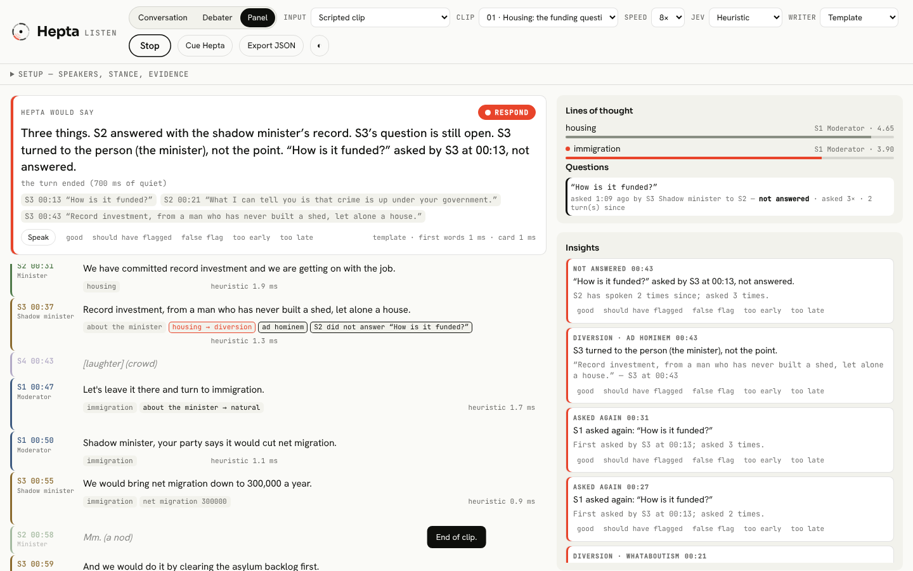

<p></p>

# Hepta Listen

**Hepta listens.** It hears who is speaking, follows the subject, notices when someone changes it, and knows when
to answer — on screen, at the speed of reading. Built for one person talking to it, for a debate in which it argues
a side, and for a TV panel a broadcast operator is watching.

This repository is the listening engine and its test bench. The measure is **listening quality and timing**, not
speech: who said what, what they moved away from, which question is still open, which figure changed — and
whether Hepta took the floor at the right moment (never mid-clause).

<p></p>

## Quick start — no keys needed

```bash
npm install
```

```bash
npm start
```

Open http://127.0.0.1:7474, pick a scripted clip, press **Start**. Scripted clips play through a simulated
streaming recognizer (partials, finals, diarization labels and their mistakes) at 1–8× speed.

```bash
npm test
```

```bash
npm run bench
```

## Keys

Copy `.env.example` to `.env`. Everything runs without keys; each key switches on a part.

| key | switches on |
| --- | --- |
| `ANTHROPIC_API_KEY` | the **Claude Haiku** Jev backend, and **Claude Sonnet** response cards (otherwise a local template writes them) |
| `DEEPGRAM_API_KEY` or `ASSEMBLYAI_API_KEY` | live **microphone**, **file** and **URL** input, and **recorded clips** in the bench |

## What it hears, on every partial transcript chunk

1. **Who** — streaming diarization (Deepgram per word, AssemblyAI per turn). Speakers become S1, S2… and keep their
   names once an operator gives them. Each utterance's speaker is the majority of its words, so a diarizer's
   wavering is absorbed (scripted bench: recognizer 95.8% → listener 99.8% of words; under heavy simulated noise
   88.8% → 98.5%). Ads and crowd noise are set aside; nods are not turns.
2. **What** — a subject per utterance, kept with continuity, and **lines of thought**: one per subject, with an owner
   and a weight (+1 on air, +0.5 when mentioned again, halved every 5 minutes).
3. **Shifts** — natural, follow-up, or **diversion**: deflection, whataboutism, ad hominem, a question dodged (put to
   someone who takes two turns without answering it), moving the goalposts, a changed figure.
4. **Claims** — with speaker and time, checked against what the same speaker said before (quoting both) and against
   an evidence pack. A contradiction sits beside the claim it contradicts; it never overwrites it until settled.
5. **Timing** — `listen` · `note` · `ready` · `respond`, on every chunk (below).
6. **Fragments** — two or three readings of a half-finished sentence; a provisional card when one clearly leads,
   confirmed or retracted when the sentence ends.

## Jev: one detector interface, two backends

```ts
interface Detector { detect(heard: Heard, state: DetectState): Judgment | Promise<Judgment> }
```

Every chunk becomes one `JevDecision`: `{ speaker, topic, shiftType, diversion?, claim?, addressedToHepta,
respondState, confidence, latencyMs }`, plus the readings alive and why the timing said what it said.

- **`heuristic`** — local, sub-millisecond: a weighted topic lexicon with continuity, cues for each diversion, the
  ported number grammar, question shape and addressee, ad/crowd/nod gates.
- **`jev-haiku`** — the same questions asked as typed Jev decisions (Choice / Noul, with probabilities and a
  runner-up) through the ported `JevTransport`, answered by **Claude Haiku 5.5**: cached system prompt, thinking off,
  low effort, one fixed JSON schema, streamed. Numbers stay local. A late answer falls back to the local judgment;
  partials already overtaken by newer ones are decided locally. The hosted Jev service plugs into the same seam.

The rules that turn a judgment into a decision do not change when the detector does.

## When Hepta speaks

- **Conversation and debater** run on the ported **Lines** rules, unchanged: cut in only at a clause boundary
  (punctuation, a joint word, a pause in the word timings) unless urgent — and nothing a listener raises is urgent,
  so **never mid-clause**; push once per disagreement; concede below 0.4 confidence on a real reason; nods are not
  turns; a point formed on half a sentence is rechecked on the whole.
- **Panel**: Hepta never cuts in. What it noticed waits as **READY** until the moderator cues it ("Hepta, anything
  to flag?") or someone asks it directly.
- **The end of a turn, not of a sentence**: an answer waits for 700 ms of quiet, moves with each further sentence,
  and waits while voice activity shows someone speaking.
- **Response cards** are written round the ported **pyramid**: the aggregator reads (the record, the evidence pack),
  the writer — **Claude Sonnet 5.5**, or a local template — gets copies and returns the card, and the congregator
  records how it was written. Short, on screen, citing who said what and when. Voice is optional and off.

## The operator screen

Response card with its READY / RESPOND light · live transcript coloured by speaker, with Jev tags inline · lines of
thought and their weights · questions not answered, with timers · insight cards, provisional → confirmed or
retracted · modes (Conversation, Debater, Panel) · inputs (scripted clip, microphone, file, URL — a TV clip plays in
the page while it is heard) · speaker names and roles, stance, evidence pack · **Cue Hepta** · tuning marks on every
decision, card and response (good · should have flagged · false flag · too early · too late) · **Export JSON**.

## Bench

`npm run bench` plays every clip through the listener and scores it against the labels; `npm run bench:report`
writes [`bench/REPORT.md`](bench/REPORT.md) with the scripted set, the held-out set and recorded clips.

| heuristic backend | scripted set (development) | held-out set (never tuned on) |
| --- | --- | --- |
| diarization (words) | 99.8% | 100.0% |
| topic shift P / R | 1.00 / 0.95 | **0.00 / 0.00** |
| diversion P / R | 1.00 / 1.00 | **0.50 / 0.20** |
| dodged questions P / R | 1.00 / 1.00 | 1.00 / 1.00 |
| contradictions P / R | 1.00 / 0.88 | 1.00 / 1.00 |
| ads & crowd · nods · addressed | 1.00 · 1.00 · 1.00 | 1.00 · 1.00 · 1.00 |
| **wrong interruptions** (target 0) | **0** | **0** |
| responses on time | 15/16 | 8/8 |
| early insights right | 8/8 | 1/2 |
| decision latency median / p95 (target < 150 ms) | 0.2 / 0.8 ms | 0.2 / 0.9 ms |

The scripted clips were labelled before any detector existed, but the rules were then tuned against them; the
held-out set was not. Structure generalises (counting turns, comparing figures, timing); vocabulary does not (new
subjects, diversions in words no cue lists). Claude Haiku, Sonnet's time to card (< 1.5 s target) and real
recognizers were **not measured in this build** — no keys. Add the keys and run `npm run bench:report`.

**Add your TV clips:** `npm run bench:draft -- --audio clip.mp4 --id my-clip`, then label the draft —
[`bench/clips/README.md`](bench/clips/README.md).

## Commands

| command | does |
| --- | --- |
| `npm start` | the studio at http://127.0.0.1:7474 |
| `npm run listen -- --file debate.mp4` | listen to a recording from the terminal (`--clip 01` for a scripted clip); saves the session to `exports/` |
| `npm run bench` | the bench (`--backends heuristic,jev-haiku`, `--set holdout`, `--clips 01,05`, `--misses`, `--onset-lag 0.5 --flicker 0.08`) |
| `npm run bench:report` | both sets → `bench/REPORT.md` |
| `npm run bench:debug -- 05` | one clip, turn by turn: labels next to decisions, threads, questions, cards |
| `npm run bench:draft -- --audio f --id x` | a draft `clip.json` from a recording |
| `npm test` · `npm run typecheck` | 297 tests · strict TypeScript |
| `npm run e2e:capture` | a file played in a real browser reaches the studio as 16 kHz PCM in real time |
| `npm run hepta` | the replay suites of the ported `hepta` package |

## Layout

| path | what |
| --- | --- |
| `packages/core`, `resolve`, `hepta`, `memory`, `pyramid` | ported from `Djoek47/tacit` — acts and commit contract; Jev transport and number grammar; **Lines** (threads, stances, floor, cut-in rules) and the speculator; memory; the **pyramid** (roles with separate authority) |
| `packages/listen` | the listening engine: types and the Jev `Detector`, heuristic and Haiku backends, speaker tracking, clause boundaries, threads, memory (questions, claims), insight cards, timing, responders, STT providers (Deepgram, AssemblyAI, scripted), audio |
| `apps/studio` | the server (WebSocket sessions, keys stay here) and the operator page |
| `bench` | clips and labels, the held-out set, the simulator's runner, scoring, reports, recorded-clip transcription |
| `tools` | the terminal listener, the clip drafter, the browser capture check |
| `brand` | the brand sheet and logo files |
| `STATUS.md` | what each build step delivered, with its numbers |

## Known limits

- **Vocabulary.** The heuristic backend misses subjects and diversions phrased outside its lexicon and cues (see
  the held-out set). The Haiku backend is the intended answer; it is built and tested against a fake client, not yet
  measured live.
- **Not run live here:** Deepgram, AssemblyAI, Claude Haiku and Sonnet — no keys in this build, and this cloud
  session's network policy also blocks the speech providers' hosts. The adapters follow the providers' documented
  wire formats and are tested against recorded messages.
- English (the ported Lines rules also know French joint words). Overlapping speech is only as separable as the
  recognizer makes it. URL input needs a direct media URL (not a streaming-site page). Voice output uses the
  browser's speech synthesis.
